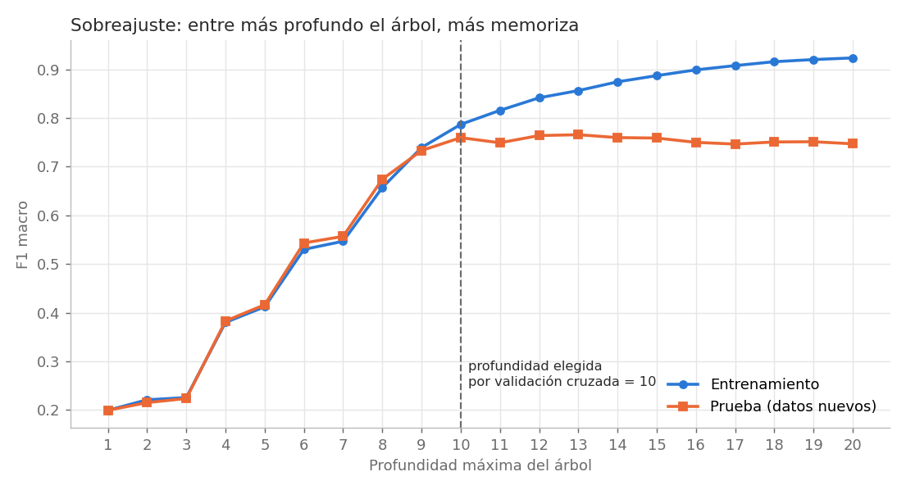
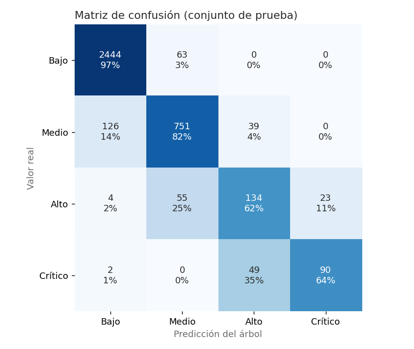
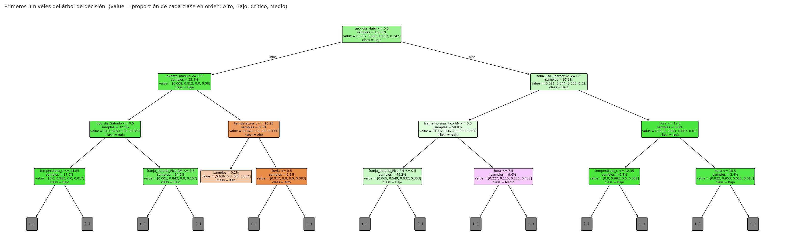

# Predicción del nivel de ocupación en TransMilenio con árboles de decisión

Proyecto de la **Actividad 3: Métodos de aprendizaje supervisado** del curso de
Inteligencia Artificial (Corporación Universitaria Iberoamericana).

## ¿Qué hace?

Entrena un **árbol de decisión** que predice si una estación de TransMilenio va a
estar en ocupación **Baja, Media, Alta o Crítica** en una hora determinada, según:

- la **hora** y la franja horaria;
- el **tipo de día** (hábil, sábado, domingo o festivo);
- el **tipo** y la **zona de uso** de la estación (residencial, empresarial,
  universitaria, intercambio o recreativa);
- si **llueve**, la **temperatura** y si hay un **evento masivo** cerca
  (concierto o partido).

Es **aprendizaje supervisado**: el modelo aprende de 15.120 registros históricos
que ya traen la respuesta correcta (el nivel de ocupación real).

Esto serviría para anticipar hacinamiento y reforzar flota o personal antes de
que la estación se llene.

## Técnicas utilizadas

- **Árbol de decisión** (`DecisionTreeClassifier`), con criterio de **entropía**
  (ganancia de información) y **Gini**.
- **Reglas de decisión SI … ENTONCES** extraídas del árbol.
- **Poda** (profundidad máxima y mínimo de ejemplos por hoja) para evitar el
  **sobreajuste**.
- **Validación cruzada** de 5 particiones (`GridSearchCV`) para elegir los
  hiperparámetros.
- Evaluación con **exactitud, precisión, exhaustividad (recall), F1 y matriz de
  confusión**.

*(Palma Méndez, J. T. (2008). Inteligencia artificial: métodos, técnicas y
aplicaciones. McGraw-Hill España. Capítulo 17: Aprendizaje de árboles y reglas de
decisión.)*

## Estructura del repositorio

```
transmilenio-arbol-decision-ia/
├── datos/                          # 1. FUENTES DE DATOS
│   ├── ocupacion_horaria.csv       #    15.135 registros: estación × día × hora, con la etiqueta
│   ├── estaciones.csv              #    30 estaciones: troncal, tipo y zona de uso
│   ├── calendario.csv              #    días de octubre de 2026: tipo de día, festivos y lluvia
│   └── eventos.csv                 #    10 eventos masivos
├── src/                            # 2. CÓDIGO FUENTE EN PYTHON
│   ├── generar_dataset.py          #    genera la muestra de datos (semilla fija)
│   ├── preparacion_datos.py        #    limpieza, integración y variables
│   ├── modelo_arbol.py             #    árbol de decisión, poda y evaluación
│   ├── visualizacion.py            #    gráficas
│   └── main.py                     #    ejecuta todo en 10 pasos
├── docs/
│   ├── descripcion_datos.md        # 3. DOCUMENTO DE DESCRIPCIÓN DE LOS DATOS
│   ├── pruebas.md                  # 4. DOCUMENTO DE PRUEBAS
│   └── mapa_conceptual.md          #    mapa conceptual del tema
├── tests/test_proyecto.py          #    15 pruebas automáticas (unittest)
├── resultados/                     #    gráficas, reglas del árbol y tablas
├── requirements.txt
└── README.md
```

## Instalación y uso

Requiere **Python 3.9 o superior**.

```bash
git clone https://github.com/JuliRSDev/transmilenio-arbol-decision-ia.git
cd transmilenio-arbol-decision-ia
pip install -r requirements.txt

python src/generar_dataset.py              # (opcional) regenera los datos; ya vienen incluidos
python src/main.py                         # entrena, evalúa y guarda resultados
python -m unittest discover -s tests -v    # pruebas automáticas
```

## Resultados principales

| Modelo | Exactitud | F1 macro |
|---|---|---|
| Línea base (siempre "Bajo") | 0,663 | 0,199 |
| Árbol sin podar (26 niveles, 1.573 hojas) | 0,874 | 0,745 |
| **Árbol podado (10 niveles, 243 hojas)** | **0,904** | **0,781** |

| | |
|---|---|
|  |  |



**Ejemplos de predicción:**

| Situación | Predicción |
|---|---|
| Portal residencial, martes 6 a. m., lloviendo | Crítico |
| Calle 72, jueves 5 p. m. | Alto |
| Universidades, domingo al mediodía | Bajo |
| El Campín, sábado 7 p. m., **con** partido | Alto |
| El Campín, sábado 7 p. m., **sin** partido | Bajo |

Detalle completo en [`docs/pruebas.md`](docs/pruebas.md). Mapa conceptual en
[`docs/mapa_conceptual.md`](docs/mapa_conceptual.md).

## Sobre los datos

Los nombres de estaciones y troncales son **reales**. La ocupación, el clima y los
eventos son una **muestra simulada** con la estructura de las fuentes oficiales
(TransMilenio S.A., Datos Abiertos Bogotá e IDEAM). **No son cifras oficiales.**
Ver [`docs/descripcion_datos.md`](docs/descripcion_datos.md).
