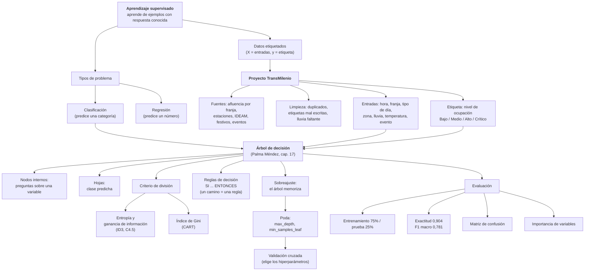

# Mapa conceptual: aprendizaje supervisado con árboles de decisión

**Cómo leerlo:** el aprendizaje supervisado necesita **datos etiquetados**. Para
un problema de **clasificación** se usa un **árbol de decisión**, que se construye
eligiendo en cada nodo la pregunta que más reduce la impureza (entropía o Gini).
Cada camino del árbol es una **regla**. Si el árbol crece sin control, se
**sobreajusta**, y por eso se **poda** con hiperparámetros elegidos por
**validación cruzada**. En el proyecto, las fuentes de TransMilenio se limpian y
se convierten en entradas y etiqueta, el árbol aprende de ellas y se evalúa con
datos que no vio durante el entrenamiento.
